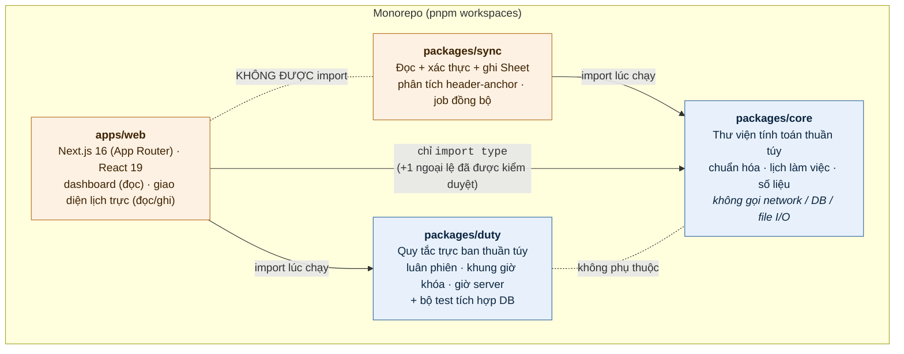
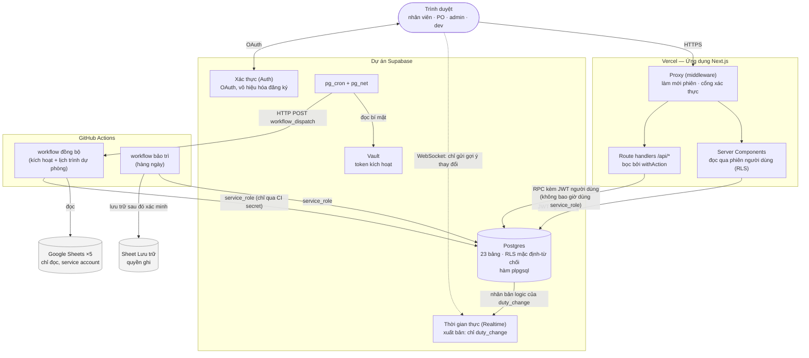
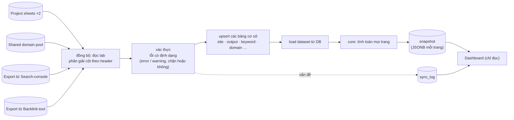
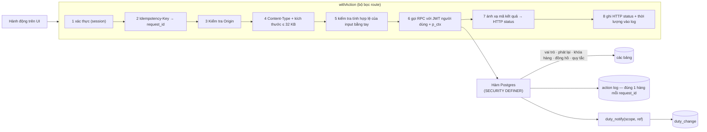

# 1. Kiến trúc Hệ thống

## 1.1 Monorepo: bốn gói, ranh giới được thực thi nghiêm ngặt

pnpm workspaces, TypeScript `strict`, Node ≥ 22. Hướng phụ thuộc (dependency) là một chiều và **được kiểm tra bằng test**, chứ không chỉ qua quy ước thông thường.

| Gói (Package) | Vai trò | Quyền I/O | Tại sao lại tách biệt |
|---|---|---|---|
| `core` | Tất cả toán học tính toán số liệu backlink: chuẩn hóa chuỗi/domain/URL/TLD, lịch làm việc (ngày lễ, ngày nghỉ, mục tiêu tích lũy), mỗi trang dashboard một hàm. | Không có | Các hàm thuần túy rất dễ để viết unit-test và không thể vô tình dính dáng đến I/O. Các bài test toàn diện sẽ chốt chặt mọi công thức trước khi phát hành. |
| `sync` | Đọc 5 Google Sheets thông qua service account, phân giải các cột theo text ở tiêu đề (header), xác thực, ghi vào Postgres, gọi `core`, ghi snapshot. | Network (Sheets, Postgres) | Được cô lập để mã duy nhất động tới sự hỗn loạn của bảng tính nằm ở một nơi; các bài test sử dụng dữ liệu bảng tính trong RAM. |
| `duty` | Thuật toán luân phiên ca, xác thực đổi ca, quyết định khóa khung giờ, ước lượng giờ máy chủ, các hàm hỗ trợ theo khu vực. | Không có (web app có thể import lúc chạy) | Cung cấp cho UI một *đặc tả* (specification) có thể thực thi được của các quy tắc; SQL cũng triển khai các quy tắc tương tự và cả hai được kiểm tra chéo bằng các bài test song song TS↔SQL. |
| `web` | UI + các route handler. Các trang backlink chỉ đọc snapshots. Các trang trực ban (on-call) đọc qua server và chỉ ghi thông qua các hàm DB. | Postgres qua phiên đăng nhập của người dùng | Triển khai (deploy) chung một khối; mã của các module không được import chéo (bắt buộc). |

### Các quy tắc ranh giới được thực thi dưới dạng test

* Bản thân các quy tắc ESLint cũng được test: một bài test sẽ đưa mã giả kèm đường dẫn file giả vào API của ESLint và khẳng định (assert) rằng quy tắc đó phải được kích hoạt (ví dụ: lệnh `import` chạy từ `core` bên trong một trang web sẽ bị từ chối; nhưng `import type` thì được phép).
* Một bài test quét mã nguồn (source-scan) đảm bảo rằng thời gian khóa khung giờ **không** xuất hiện trong bất kỳ file mã nguồn nào (chúng chỉ nằm ở một hàng duy nhất trong DB).
* Một bài test độ bao phủ route (route-coverage) khẳng định mọi route ghi (`POST/PATCH/PUT/DELETE`) đều được bọc (wrapped) — bởi một action wrapper (cho on-call) hoặc log wrapper chỉ-quan-sát (cho backlink). Danh sách miễn trừ trống rỗng; nếu thêm một route ghi mà không bọc, test sẽ báo lỗi (red).
* Mã trực ban (on-call) và mã backlink không được import lẫn nhau; chúng chỉ chia sẻ module identity, bảng nhân viên và vỏ UI.

## 1.2 Cấu trúc mạng (topology) lúc chạy

### Các thành phần và trách nhiệm

| Thành phần | Trách nhiệm | Ghi chú |
|---|---|---|
| Trình duyệt | Render giao diện; ước tính giờ máy chủ; đăng ký nhận *gợi ý* thời gian thực. | Không bao giờ giữ cookie phiên thực sự (`httpOnly`); chỉ nhận token thời hạn ngắn, giới hạn phạm vi dành cho kênh thời gian thực. |
| Proxy | Làm mới phiên đăng nhập trên mỗi request; chuyển hướng người dùng chưa đăng nhập; trả về `401 JSON` cho `/api/*`. | Không phải là cổng duy nhất — các pages, hàm DB và RLS đều sẽ kiểm tra lại. |
| Server Components | Đọc dữ liệu bằng phiên của **người dùng** để RLS được áp dụng. | Dashboard backlink chỉ đọc từ `snapshot` và `sync_log`. |
| Route handlers | Mọi thao tác ghi đều đi qua một bộ bọc duy nhất (xem §1.4). | Danh tính đến từ phiên (session), không bao giờ lấy từ request body. |
| Postgres | Nguồn sự thật (source of truth) *và* engine quy tắc cho thao tác ghi: xác thực, phân quyền, quyết định khung giờ, ghi log kiểm toán, tính lũy đẳng — tất cả nằm trong các hàm `SECURITY DEFINER`. | RLS từ chối mặc định; người dùng đã đăng nhập không được ghi trực tiếp vào bảng. |
| Thời gian thực (Realtime) | Đẩy các gợi ý "có gì đó thay đổi" từ một bảng duy nhất `duty_change`. | Không mang dữ liệu nghiệp vụ (xem ADR-4). |
| `pg_cron` + `pg_net` + Vault | Kích hoạt job đồng bộ theo thời gian thực tế chính xác. | Xem ADR-2 và chuỗi S2. |
| GitHub Actions | Chạy job đồng bộ và job bảo trì hàng ngày. | Key service-role và key Google chỉ nằm trong CI secrets. |

## 1.3 Luồng dữ liệu

Hệ quả thiết kế: **UI không thực hiện tính toán.** Mọi con số mà dashboard hiển thị đều được tính toán phía server bởi job đồng bộ và lưu trữ dưới dạng payload JSONB cho mỗi cặp (site, trang). Một phân tích lỗi chỉ làm hỏng một khối, không hỏng cả trang.

## 1.4 Luồng ghi của module trực ban (ngoại lệ được bảo vệ)

Module backlink chỉ cho phép đọc trên UI. Module trực ban (on-call) *phải* chấp nhận các thao tác ghi từ người dùng, do đó chúng được dẫn qua chính xác một con đường:

Các quy tắc của luồng này:

1. **Không sử dụng `service_role` cho hành động của người dùng.** Hàm chạy với quyền của người định nghĩa (definer), nhưng danh tính được đọc từ JWT của người gọi.
2. **Không tồn tại tham số "ai đã làm"** trên bất kỳ hàm nào. Mọi hàm chỉ nói về *người gọi* (caller).
3. **Các lỗi nghiệp vụ bị từ chối là giá trị trả về**, không phải exception, để giao dịch (transaction) cùng được commit với một hàng audit trạng thái `rejected`. Chỉ các lỗi không mong muốn mới raise (và roll back).
4. **Việc ghi log không bao giờ làm hỏng hành động chính**: việc chèn log chạy trong một khối phụ; nếu thất bại chỉ cảnh báo. Một hàm đối chiếu (`log_gaps`) sẽ tìm các hàng nghiệp vụ không có log và công việc hàng ngày sẽ báo lỗi lớn nếu tồn tại khoảng trống này.

## 1.5 Mô hình bảo mật (phòng thủ đa lớp)

| Lớp | Kiểm soát |
|---|---|
| Mạng/UI | Cổng Proxy; định tuyến `noindex` khi cần; trang log dành riêng cho dev trả về 404 (chứ không phải 403) để che giấu sự tồn tại của nó — nhưng *sự che giấu không bao giờ là biện pháp kiểm soát chính*. |
| Máy chủ | Kiểm tra vai trò cấp trang (page-level); kiểm tra origin; giới hạn kích thước body; xóa thông tin bí mật khỏi log. |
| Các hàm DB | Vai trò được lấy từ email JWT **và** provider claim; các hàm hỗ trợ vai trò là `SECURITY DEFINER` với `search_path` rỗng; tước quyền `EXECUTE` khỏi `PUBLIC`. |
| Row-Level Security (Bảo mật cấp hàng) | Mặc định-từ chối (xem đoạn mã 4.3). Truy cập bị từ chối sẽ nhận được lỗi `permission denied` thật (SQLSTATE `42501`), không phải một danh sách rỗng. |
| Bí mật (Secrets) | Key service-role + key Google chỉ nằm trong CI secrets; token kích hoạt trong DB vault; sheet lưu trữ là nơi duy nhất có quyền ghi vào Google. |
| Dữ liệu nguồn | Job đồng bộ không bao giờ ghi vào Google Sheets. Các cột có thể chứa thông tin đăng nhập không bao giờ được đọc, ghi log hoặc lưu trữ. |

## 1.6 Pipeline phân phối (Delivery pipelines)

| Pipeline | Kích hoạt (Trigger) | Ngăn ngừa trùng lặp | Báo hiệu thất bại |
|---|---|---|---|
| Đồng bộ dữ liệu | Chính: `pg_cron` → `workflow_dispatch` vào đúng giờ. Dự phòng: GitHub `schedule` (được biết là có thể chạy muộn hàng giờ) | Lần chạy dự phòng tự động bỏ qua nếu đã có một lần chạy thành công trong vòng 12h qua; nhóm `concurrency` trong CI; Mutex "đang chạy" cấp độ DB với thời gian hết hạn sau 30 phút. | Các hàng `sync_log` theo từng nguồn với trạng thái `success / partial / failed`; mã thoát (exit code) của job. |
| Bảo trì | Lịch `schedule` hàng ngày trên GitHub nằm ngoài khung giờ bận rộn. | Nhóm `concurrency` trong CI | Job báo đỏ (e-mail từ CI) khi: thiếu hàng log, vượt ngưỡng kích thước, lỗi lưu trữ hoặc bất kỳ bước nào không thể chạy. |

## 1.7 Các quyết định thiết kế chính

Các ghi chép quyết định ngắn gọn (ADR). Mỗi mục liệt kê những gì bị từ chối và lý do.

### ADR-1 — Đọc cột bảng tính theo tiêu đề, không phải theo chữ cái cột
* **Bối cảnh:** Các sheet nguồn được chỉnh sửa bởi những người không phải kỹ sư; các cột có thể bị chèn, gộp và đổi tên.
* **Quyết định:** Xác định vị trí hàng tiêu đề (header) bằng các tiêu đề neo (anchor), chia hàng đó thành các khối dựa trên tiêu đề bắt-đầu-khối, khớp các trường bằng chữ đã chuẩn hóa cùng với các bí danh. Xem đoạn mã 4.1.
* **Bị từ chối:** Dùng chữ cái cột cố định (sẽ hỏng nếu chèn cột); yêu cầu nhóm không thay đổi cấu trúc bảng (buộc phải thay đổi workflow — ràng buộc sản phẩm cốt lõi là *không thay đổi cách nhóm làm việc*).
* **Hệ quả:** Mọi vấn đề phân tích đều trở thành lỗi có định dạng; cột không xác định sẽ cảnh báo nhưng không chặn; thiếu các trường bắt buộc chỉ chặn đúng tab đó.

### ADR-2 — `pg_cron` làm bộ lập lịch chính, GitHub `schedule` làm dự phòng
* **Bối cảnh:** Bộ lập lịch `schedule:` của GitHub được quan sát thấy chạy chậm 5–9 giờ.
* **Quyết định:** `pg_cron` gọi GitHub `workflow_dispatch` REST API thông qua `pg_net` vào thời gian chính xác; token được lưu trong Vault. Lịch trình gốc đóng vai trò dự phòng, trước tiên nó kiểm tra log đồng bộ và bỏ qua nếu đã có một lần chạy thành công.
* **Bị từ chối:** Sử dụng dịch vụ scheduler chạy liên tục (tốn thêm chi phí hạ tầng và bảo mật); chuyển toàn bộ job vào Postgres (Sheets API + parser không thuộc về nơi này).
* **Hệ quả:** Hai lớp độc lập ngăn chặn sự chồng chéo (CI concurrency group + DB mutex), do đó sự dư thừa không bao giờ tạo ra các lần chạy trùng lặp.

### ADR-3 — Quyết định quy tắc khung giờ bên trong giao dịch DB, với đồng hồ DB
* **Bối cảnh:** Việc đổi ca bị cấm trong một khung giờ cố định mỗi ngày; đồng hồ của client hoặc app-server có thể sai, và việc kiểm tra *trước khi* lấy khóa hàng sẽ tạo ra race condition (điều kiện tương tranh).
* **Quyết định:** Hàm lấy khóa hàng trước, **sau đó** đọc đồng hồ, sau đó mới xác thực. UI chỉ làm mờ nút và hiển thị đồng hồ đếm ngược được ước tính từ các mẫu giờ server. Xem chuỗi S1.
* **Bị từ chối:** Chỉ chặn bằng UI (dễ bị qua mặt); kiểm tra trên app-server (chênh lệch đồng hồ + rủi ro race condition giữa bước check và write); bù giờ deadline trên client (sẽ chặn các yêu cầu hợp lệ và che giấu quy tắc thực sự).
* **Hệ quả:** Ranh giới chính xác có thể test tới từng mili-giây; một yêu cầu đến muộn một chút sẽ bị từ chối rõ ràng.

### ADR-4 — Realtime (Thời gian thực) mang theo gợi ý, không phải dữ liệu
* **Bối cảnh:** Đẩy dữ liệu hàng qua kênh thời gian thực cần xác thực từng hàng (authorization) trên stream và tạo ra bề mặt tấn công lớn hơn.
* **Quyết định:** Chỉ có `duty_change(scope, ref, at)` được phát đi. Client khi nhận được gợi ý sẽ tự động lấy lại dữ liệu thông qua đường server thông thường (chạy lại RLS + role checks). Dự phòng fallback bằng polling 5 giây và trạng thái kết nối hiển thị rõ sẽ bao quát trường hợp mạng chập chờn; đối chiếu định kỳ nhẹ nhàng sẽ bao quát trường hợp kênh realtime im lặng.
* **Bị từ chối:** Xuất bản các bảng dữ liệu nghiệp vụ; tin tưởng payload của event như dữ liệu gốc.
* **Hệ quả:** Một sự kiện bị rò rỉ hoặc bị replay sẽ không tiết lộ thông tin gì; tính đúng đắn không bao giờ phụ thuộc vào kênh realtime.

### ADR-5 — Từ chối mặc định ở cấp độ schema
* **Quyết định:** Thu hồi mọi đặc quyền mặc định cho `anon` / `authenticated`, sau đó cấp quyền `SELECT` hẹp cho từng bảng. Bảng mới sẽ bị khóa tự động. Xem đoạn mã 4.3.
* **Bị từ chối:** Phụ thuộc vào việc "mọi bảng đều phải có chính sách RLS" (nếu quên một chính sách, bảng sẽ bị hở vì các quyền vẫn được cấp theo mặc định).

### ADR-6 — Logic nghiệp vụ là các gói hàm thuần túy + một phiên bản sinh đôi bằng SQL
* **Quyết định:** Các quy tắc mà UI cần phải *giải thích* (luân phiên, khóa khung giờ) tồn tại dưới dạng các hàm TS thuần túy **và** dạng plpgsql; một bộ test song song chạy cùng một kịch bản với cả hai phiên bản.
* **Bị từ chối:** Chỉ dùng TS (DB phải tự quyết định); chỉ dùng SQL (UI không thể render bộ đếm ngược / bản xem trước mà không thực hiện round-trip tới server).
* **Hệ quả:** Một lỗi thực sự thuộc loại này đã bị phát hiện bởi các bài test song song (`NULL IN (…)` đánh giá thành NULL đã âm thầm bỏ qua một bước kiểm tra quyền) — xem ghi chú ở đoạn mã 4.4.

### ADR-7 — Vòng đời dữ liệu đóng an toàn (Fail-closed)
* **Quyết định:** Các hàng audit cũ được lưu trữ vào bảng tính, **đọc lại và xác minh từng hàng**, rồi mới bị xóa bằng ID rõ ràng. Bất kỳ thất bại nào cũng sẽ dừng việc xóa. Xem đoạn mã 4.8.
* **Bị từ chối:** Xóa theo thời gian ngắt (khoảng cách giữa save và delete có thể làm mất hàng); lưu trữ kiểu cố gắng hết sức (best-effort).