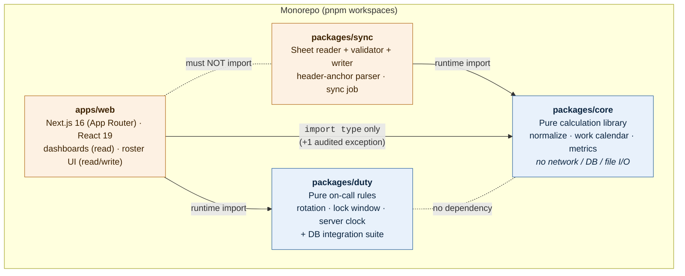
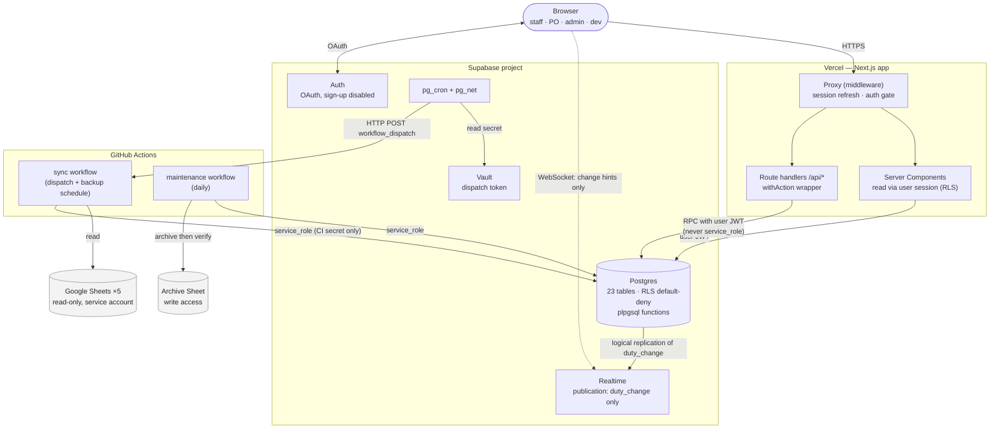
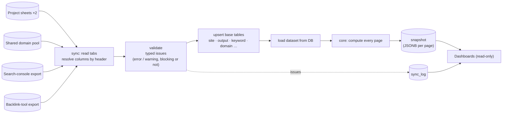
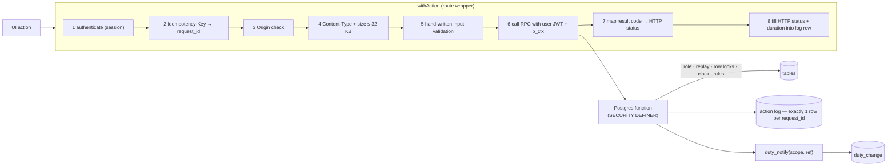

# 1. System Architecture

## 1.1 Monorepo: four packages, enforced boundaries

pnpm workspaces, TypeScript `strict`, Node ≥ 22. Dependency direction is one-way and **checked by tests**, not
only by convention.

| Package | Role | I/O allowed | Why it is separate |
|---|---|---|---|
| `core` | All backlink metric math: string/domain/URL/TLD normalization, work-calendar (holidays, off-days, cumulative targets), one function per dashboard page. | None | Pure functions are trivially unit-testable and cannot drift into I/O. Exhaustive tests pin every formula before it ships. |
| `sync` | Reads 5 Google Sheets through a service account, resolves columns by header text, validates, writes Postgres, calls `core`, writes snapshots. | Network (Sheets, Postgres) | Isolated so that the only code touching spreadsheet chaos is in one place; tests use an in-memory sheet source. |
| `duty` | Rotation algorithm, swap validation, lock-window decision, server-clock estimator, region helpers. | None (runtime-importable by the web app) | Gives the UI an executable *specification* of the rules; the SQL implements the same rules and the two are cross-checked by parallel TS↔SQL tests. |
| `web` | UI + route handlers. Backlink pages only read snapshots. On-call pages read via server and write only through DB functions. | Postgres via user session | Single deployable; module code does not import across modules (enforced). |

### Boundary rules enforced as tests

* ESLint rules are themselves tested: a test feeds inline code with a fake file path to the ESLint API and asserts
  the rule fires (e.g. a runtime `import` from `core` inside a page is rejected; `import type` is allowed).
* A source-scan test asserts that the lock-window times appear in **no** source file (they live in one DB row).
* A route-coverage test asserts every write route (`POST/PATCH/PUT/DELETE`) is wrapped — by the action wrapper (on-call) or by an observe-only external-log wrapper (backlink routes). The exemption list is empty; adding an unwrapped write route turns the test red.
* On-call code and backlink code must not import each other; they share only identity, staff table and UI shell.

## 1.2 Runtime topology

### Components and responsibilities

| Component | Responsibility | Notes |
|---|---|---|
| Browser | Renders UI; estimates server time; subscribes to realtime *hints*. | Never holds the real session cookie (`httpOnly`); gets a short-lived, scope-limited token only for the realtime channel. |
| Proxy | Refreshes the auth session on every request; redirects anonymous users; returns `401 JSON` for `/api/*`. | Not the only gate — pages, DB functions and RLS each re-check. |
| Server Components | Read data using the **user's** session so RLS applies. | The backlink dashboards read only `snapshot` and `sync_log`. |
| Route handlers | Every write goes through one wrapper (see §1.4). | Identity comes from the session, never from the request body. |
| Postgres | Source of truth *and* rule engine for writes: validation, authorization, time-window decisions, audit logging, idempotency — all in `SECURITY DEFINER` functions. | Default-deny RLS; no direct table writes for signed-in users. |
| Realtime | Pushes "something changed" hints from a single `duty_change` table. | Carries no business data (see ADR-4). |
| `pg_cron` + `pg_net` + Vault | Fire the sync workflow at the exact wall-clock time. | See ADR-2 and sequence S2. |
| GitHub Actions | Runs the sync job and the daily maintenance job. | Service-role key and Google key live only in CI secrets. |

## 1.3 Data flows

Design consequence: **the UI does no calculation.** Every number a dashboard shows was computed server-side by the
sync job and stored as a JSONB payload per (site, page). A bad parse degrades one block, not the whole page.

## 1.4 Write path of the on-call module (the guarded exception)

The backlink module is read-only in the UI. The on-call module *must* accept user writes, so they are channelled
through exactly one path:

Rules of this path:

1. **No `service_role` for user actions.** The function runs as definer, but identity is read from the caller's JWT.
2. **No "who did it" parameter** exists on any function. Every function talks about the *caller* only.
3. **Business rejections are return values**, not exceptions, so the transaction commits together with a
   `rejected` audit row. Only unexpected failures raise (and roll back).
4. **Logging can never break the action**: the log insert runs in a sub-block; failure only raises a warning.
   A reconciliation function (`log_gaps`) finds business rows with no log row, and the daily job fails loudly if any exist.

## 1.5 Security model (defense in depth)

| Layer | Control |
|---|---|
| Network/UI | Proxy gate; routes `noindex` where required; the dev-only log page returns 404 (not 403) to hide its existence — but *obscurity is never the control*. |
| Server | Page-level role checks; origin check; body size limit; secrets redacted from logs. |
| Database functions | Role derived from JWT e-mail **and** provider claim; role helper functions are `SECURITY DEFINER` with empty `search_path`; `EXECUTE` revoked from `PUBLIC`. |
| Row-Level Security | Default-deny (see snippet 4.3). Denied access is a real `permission denied` (SQLSTATE `42501`), not an empty list. |
| Secrets | Service-role key + Google key only in CI secrets; dispatch token in the DB vault; archive sheet is the only place with write access to Google. |
| Source data | The sync job never writes to Google Sheets. Columns that may contain credentials are never read, logged or stored. |

## 1.6 Delivery pipelines

| Pipeline | Trigger | Guard against duplicates | Failure signalling |
|---|---|---|---|
| Data sync | Primary: `pg_cron` → `workflow_dispatch` at exact time. Backup: GitHub `schedule` (known to run hours late) | Backup run self-skips if a successful run exists in the last 12 h; CI `concurrency` group; DB-level "running" mutex with 30-min staleness expiry | Per-source `sync_log` rows with status `success / partial / failed`; job exit code |
| Maintenance | Daily GitHub `schedule` outside the busy window | CI `concurrency` group | Job goes red (e-mail from CI) on: missing log rows, size threshold exceeded, archive failure, or any step that could not run |

## 1.7 Key design decisions

Short-form decision records. Each lists what was rejected and why.

### ADR-1 — Read spreadsheet columns by header text, not by column letter
* **Context:** the source sheets are edited by non-engineers; columns get inserted, merged and renamed.
* **Decision:** locate the header row by anchor titles, split the row into blocks by block-start anchors, match fields by normalized text with aliases. See snippet 4.1.
* **Rejected:** fixed column letters (breaks on any insert); asking the team to freeze the layout (forces a workflow change — the explicit product constraint was *no change to how the team works*).
* **Consequence:** every parse problem is a typed issue; unknown columns warn but never block; missing required fields block only that tab.

### ADR-2 — `pg_cron` as the primary scheduler, GitHub `schedule` as a guarded backup
* **Context:** GitHub's `schedule:` was observed running 5–9 hours late.
* **Decision:** `pg_cron` calls the GitHub `workflow_dispatch` REST API through `pg_net` at the exact time; token stored in Vault. The native schedule stays as a backup that first checks the sync log and skips if a run already succeeded.
* **Rejected:** a long-running scheduler service (extra infrastructure to run and secure); moving the whole job into Postgres (Sheets API + parser do not belong there).
* **Consequence:** two independent layers prevent overlap (CI concurrency group + DB mutex), so redundancy never produces duplicate runs.

### ADR-3 — Decide time-window rules inside the DB transaction, with the DB clock
* **Context:** swaps are forbidden in a daily window; a client or app-server clock can be wrong, and checking *before* taking row locks leaves a race.
* **Decision:** the function takes row locks first, **then** reads the clock, then validates. The UI only dims buttons and shows a countdown estimated from server time samples. See sequence S1.
* **Rejected:** UI-only gating (bypassable); app-server check (clock skew + race between check and write); padding the deadline client-side (would block valid requests and hide the true rule).
* **Consequence:** the exact boundary is testable to the millisecond; a request that lands a moment late gets a clear rejection.

### ADR-4 — Realtime carries hints, never data
* **Context:** pushing row data over a realtime channel needs per-row authorization on the stream and exposes more surface.
* **Decision:** only `duty_change(scope, ref, at)` is published. A client that receives a hint refetches through the normal server path (RLS + role checks run again). A 5-second polling fallback and a visible connection-state indicator cover flaky networks; a light periodic reconciliation covers a silent channel.
* **Rejected:** publishing business tables; trusting event payloads as data.
* **Consequence:** a leaked or replayed event reveals nothing; correctness never depends on the channel.

### ADR-5 — Default-deny at the schema level
* **Decision:** revoke every default privilege for `anon` / `authenticated`, then grant narrow `SELECT` per table. New tables are locked automatically. See snippet 4.3.
* **Rejected:** relying on "every table has a policy" (a forgotten policy fails open when privileges are granted by default).

### ADR-6 — Business logic as pure packages + a SQL twin
* **Decision:** rules that the UI needs to *explain* (rotation, lock window) exist as pure TS functions **and** as plpgsql; a parallel test suite runs the same scenario table against both.
* **Rejected:** TS only (the DB must decide); SQL only (the UI cannot render countdowns / previews without a round trip).
* **Consequence:** a real bug of this kind was caught by the parallel tests (a `NULL IN (…)` evaluating to NULL silently skipped an authorization check) — see the note in snippet 4.4.

### ADR-7 — Fail-closed data lifecycle
* **Decision:** old audit rows are archived to a spreadsheet, **read back and verified per row**, and only then deleted by explicit ID. Any failure stops deletion. See snippet 4.8.
* **Rejected:** delete-by-cutoff-time (a gap between save and delete can lose rows); best-effort archive.
