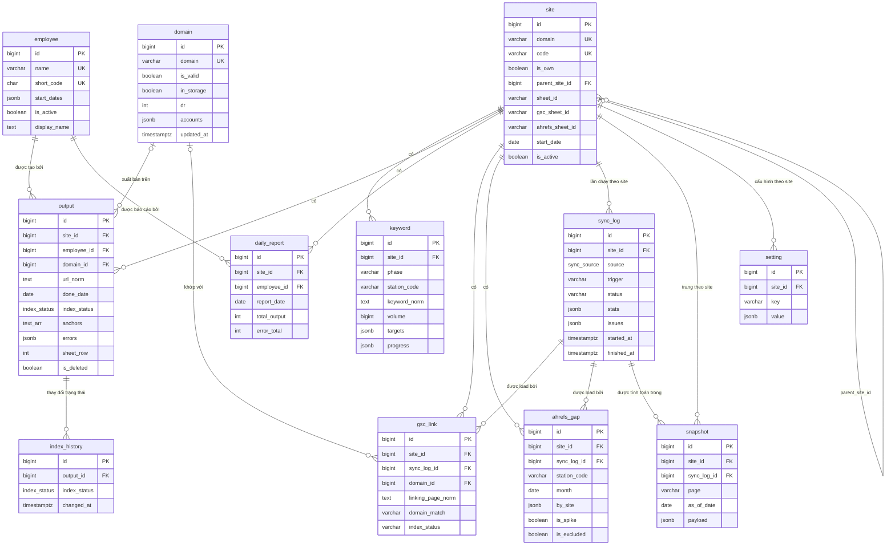
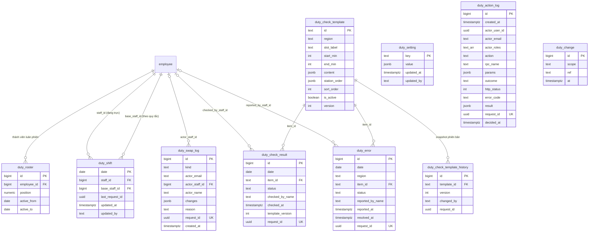
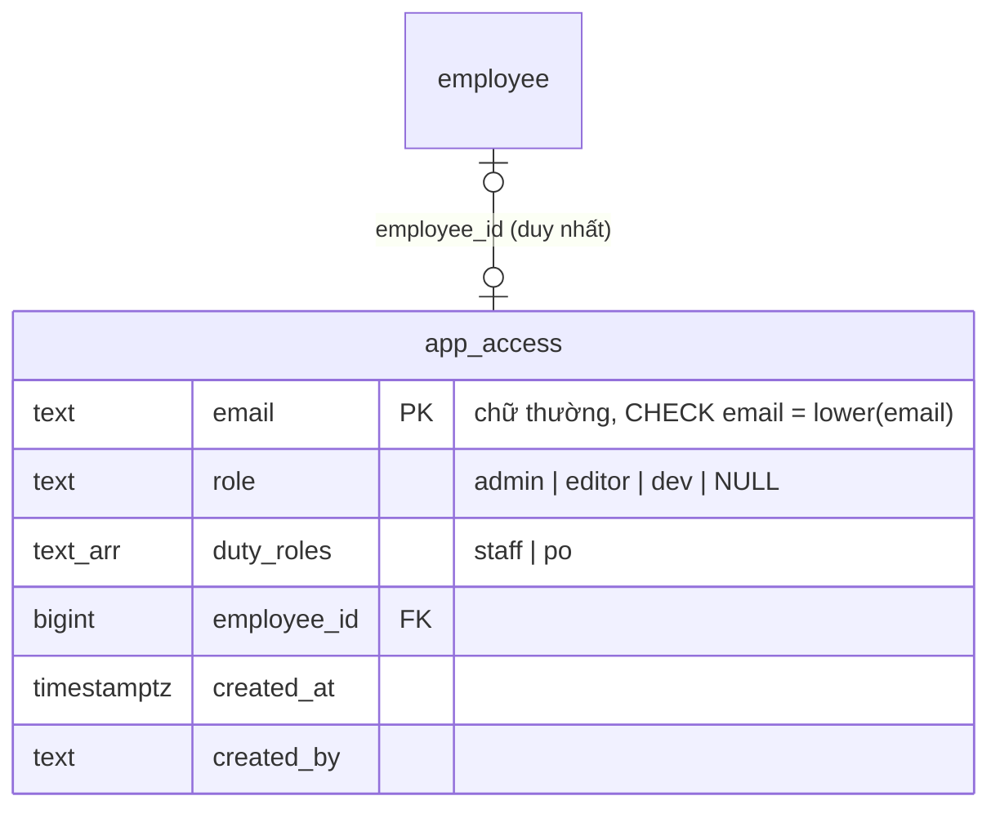

# 2. ERD — Mô hình dữ liệu (23 bảng)

Sử dụng một cơ sở dữ liệu Postgres duy nhất, một schema `public`, được phân chia bằng **quy ước đặt tên**: các bảng backlink có tên đơn giản, bảng trực ban có tiền tố `duty_`. Chúng dùng chung `employee` và `app_access`.

| Nhóm | Các bảng | Số lượng |
|---|---|---|
| Theo dõi Backlink | `site`, `employee`, `domain`, `keyword`, `output`, `daily_report`, `index_history`, `gsc_link`, `ahrefs_gap`, `setting`, `sync_log`, `snapshot` | 12 |
| Truy cập chung | `app_access` | 1 |
| Lịch Trực ban | `duty_setting`, `duty_roster`, `duty_shift`, `duty_swap_log`, `duty_action_log`, `duty_change`, `duty_check_template`, `duty_check_template_history`, `duty_check_result`, `duty_error` | 10 |

Tất cả 23 bảng đều bật RLS. Người dùng nặc danh (anonymous) chỉ có thể đọc nhiều nhất là `snapshot` (trừ trang settings) và `sync_log`.

## 2.1 Module Backlink

Enums: `index_status` = `indexed | not_indexed | http_404 | submitted | blank | other`;
`sync_source` = `site_sheet | domain_storage | gsc_sheet | ahrefs_sheet`.

### Các bất biến (invariants) của Schema Backlink

| Bất biến | Cơ chế | Lý do |
|---|---|---|
| Một hàng output cho mỗi `(site, nhân viên, URL đã chuẩn hóa)` | `UNIQUE (site_id, employee_id, url_norm)` | Các URL trùng lặp trong một tab sẽ thu gọn thành một hàng và gây ra lỗi `duplicate_url` thay vì đếm trùng hai lần. |
| `sheet_row` chỉ mang tính thông tin | Không phải là khóa | Các hàng sẽ di chuyển trong bảng tính; khóa phải được bắt nguồn từ nội dung. |
| Lịch sử chỉ lưu khi thay đổi trạng thái | insert-on-change vào `index_history` | Tăng trưởng có giới hạn; bảng không thể được xây dựng lại từ bất kỳ nguồn nào khác. |
| Một cấu hình cho mỗi `(site, key)` bao gồm các khóa chia sẻ | `UNIQUE NULLS NOT DISTINCT (site_id, key)` | Cho phép upsert `ON CONFLICT` đối với các hàng mà `site_id IS NULL`. |
| Chỉ có một tiến trình đồng bộ đang chạy trên mỗi nguồn | Partial unique index trên `sync_log (source, site_id) NULLS NOT DISTINCT WHERE status = 'running'` | Mutex cấp độ DB (đoạn mã 4.7). |
| Snapshot là thứ duy nhất UI đọc | Cấp quyền (Grants): `SELECT` chỉ trên `snapshot`, `sync_log` | UI không được phụ thuộc vào các bảng dữ liệu thô. |

## 2.2 Module Trực ban

Cố ý **không sử dụng khóa ngoại (foreign key)** từ `duty_action_log.actor_user_id` đến bất kỳ bảng user nào: việc xóa một tài khoản không bao giờ được phép xóa dấu vết kiểm toán.

### Các bất biến của Schema Trực ban

| Bất biến | Cơ chế | Lý do |
|---|---|---|
| Một ca trực cho mỗi ngày làm việc, chỉ Thứ 2–Thứ 6 | `date` là Khóa chính (PK); `CHECK (isodow BETWEEN 1 AND 5)` | Ngày *chính là* danh tính của một ca; cuối tuần không thể tồn tại. |
| `staff_id` vs `base_staff_id` | Hai cột | `staff_id` = ai đang làm nhiệm vụ ngay bây giờ; `base_staff_id` = quy tắc luân phiên chỉ định ai. Nếu chúng khác nhau ⇔ ca trực đã bị đổi, điều này khiến thao tác "đặt lại theo lịch trình" cực kỳ dễ dàng. |
| Thành viên luân phiên: cùng một người ⇒ cùng một `position`; hai người không bao giờ chung một position; không chồng chéo thời gian đối với một người | Trigger `duty_roster_guard` dưới khóa `pg_advisory_xact_lock` | Nối tiếp hóa việc chỉnh sửa lịch đồng thời; `position` có kiểu `numeric` để người mới có thể được chèn giữa 2 và 3 dưới dạng số 2.5. |
| `active_to` là ngoại trừ (exclusive) | Khoảng nửa mở `[active_from, active_to)` | Xóa bỏ sự mơ hồ "ngày cuối cùng có được bao gồm không?". |
| **Tính lũy đẳng (Idempotency)** | `request_id uuid UNIQUE` trên mọi bảng ghi | Yêu cầu thử lại không bao giờ có thể tạo ra hàng thứ hai. |
| **Đúng một hàng audit cho mỗi hành động** | `UNIQUE (request_id)` trên `duty_action_log` | Tỉ lệ 1-1 giữa hành động và hàng log; mọi thiếu sót đều có thể phát hiện bằng kiểm tra đối chiếu. |
| Tên được lưu dạng snapshot | `actor_name`, `checked_by_name`, `item_name`, `slot_label`, `template_version` được sao chép lúc ghi | Lịch sử vẫn đúng sau khi nhân viên nghỉ việc hoặc biểu mẫu được chỉnh sửa. |
| Máy trạng thái lỗi | `CHECK ((status='open' AND resolved_* IS NULL) OR (status<>'open' AND resolved_at/by NOT NULL))` | Lỗi không thể ở trạng thái "resolved" nếu không có người xử lý và timestamp. |
| Định dạng nội dung Check | Dùng `CHECK` với `jsonb_path_query_array(... type())` | Chỉ cho phép mảng chuỗi, được xác thực ngay trong DB, không chỉ tại API. |
| Realtime phơi bày một bảng | Lệnh xuất bản (Publication) chỉ chứa `duty_change` | Xem ADR-4. Các hàng cũ hơn 1 ngày sẽ bị dọn dẹp. |
| Action log chỉ dành cho dev | RLS: chỉ role `dev` mới được `SELECT`; không nằm trong publication | Nhật ký có thể chứa chi tiết vận hành; admin cố tình bị loại trừ. |

## 2.3 Các bảng kiểm soát truy cập

| Ràng buộc (Constraint) | Ý nghĩa |
|---|---|
| `role IS NOT NULL OR cardinality(duty_roles) > 0` | Một hàng mà không có vai trò gì là vô nghĩa. |
| `'staff' ∈ duty_roles ⇒ employee_id IS NOT NULL` | Một nhân viên phải được liên kết với người sở hữu ca trực của họ. |
| `UNIQUE (employee_id)` | Mỗi người một tài khoản. |
| Chỉ `dev` mới được tạo/sửa/xóa một hàng có `role = 'dev'` | Ngăn chặn admin tự leo quyền thành role duy nhất có thể đọc được audit log. |

### Ma trận vai trò (Role matrix)

| Khả năng | staff | po | admin | dev | editor |
|---|---|---|---|---|---|
| Xem dữ liệu trực ban | ✔ | ✔ | ✔ | ✔ | ✘ |
| Đánh dấu checklist OK / Error | ✔ | ✔ | ✔ | ✔ | ✘ |
| Đổi ca của chính mình | ✔ | ✔ | ✔ | ✔ | ✘ |
| Đổi ca của bất kỳ ai, đổi 1 chiều, đặt lại ca | ✘ | ✔ | ✔ | ✔ | ✘ |
| Sửa cấu hình (các khóa backlink "level-1") | ✘ | ✘ | ✔ | ✔ | ✔ |
| Đọc trang action log | ✘ | ✘ | ✘ | ✔ | ✘ |

Quy tắc danh tính dùng chung bởi tất cả helper: **e-mail claim** của người gọi phải khớp với bảng `app_access` **và** mảng `app_metadata.providers` trong token phải chứa nhà cung cấp OAuth. `app_metadata` chỉ có thể được thay đổi bởi quyền service role; `user_metadata` cho phép người dùng tự sửa và **không bao giờ** được sử dụng.