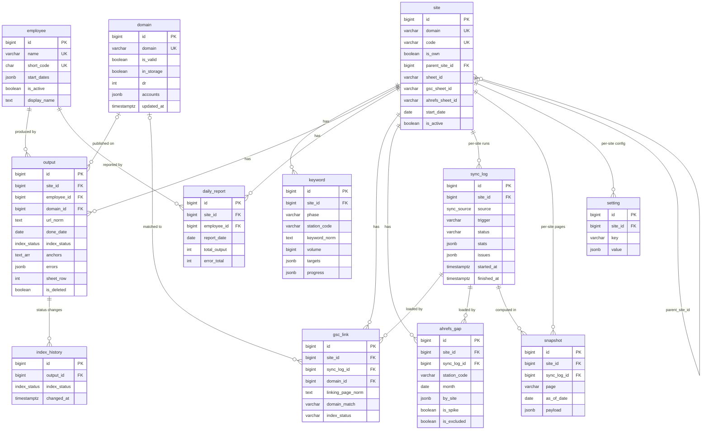
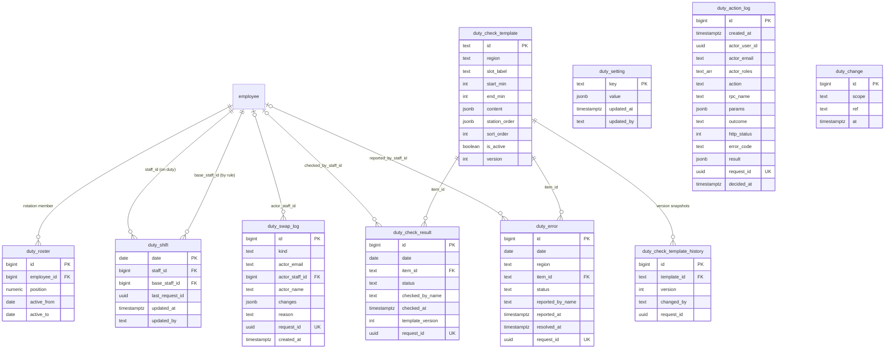
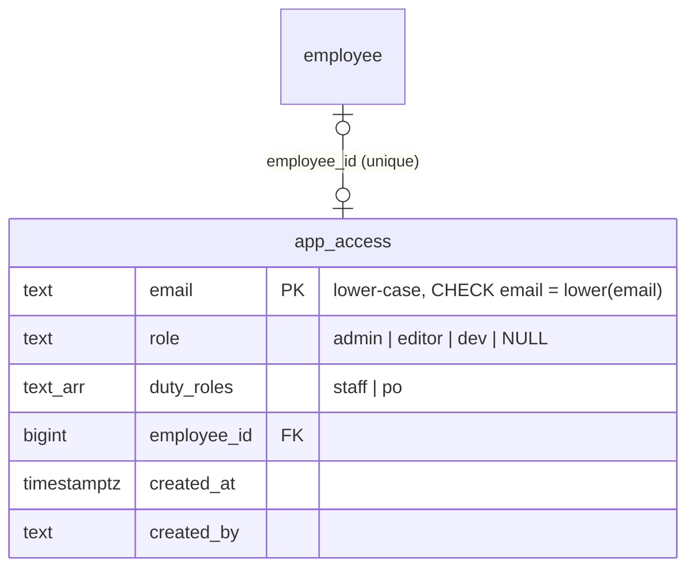

# 2. ERD — Data Model (23 tables)

One Postgres database, one `public` schema, split by **naming convention**: backlink tables have plain names,
on-call tables are prefixed `duty_`. They share `employee` and `app_access`.

| Group | Tables | Count |
|---|---|---|
| Backlink tracking | `site`, `employee`, `domain`, `keyword`, `output`, `daily_report`, `index_history`, `gsc_link`, `ahrefs_gap`, `setting`, `sync_log`, `snapshot` | 12 |
| Shared access | `app_access` | 1 |
| On-call roster | `duty_setting`, `duty_roster`, `duty_shift`, `duty_swap_log`, `duty_action_log`, `duty_change`, `duty_check_template`, `duty_check_template_history`, `duty_check_result`, `duty_error` | 10 |

All 23 tables have RLS enabled. Anonymous users can read at most `snapshot` (minus the settings page) and `sync_log`.

## 2.1 Backlink module

Enums: `index_status` = `indexed | not_indexed | http_404 | submitted | blank | other`;
`sync_source` = `site_sheet | domain_storage | gsc_sheet | ahrefs_sheet`.

### Backlink schema invariants

| Invariant | Mechanism | Why |
|---|---|---|
| One output row per `(site, employee, normalized URL)` | `UNIQUE (site_id, employee_id, url_norm)` | Duplicate URLs in a tab collapse to one row and raise a `duplicate_url` issue instead of double-counting. |
| `sheet_row` is informational only | Not part of any key | Rows move in a sheet; keys must be content-derived. |
| History only when status changes | `index_history` insert-on-change | Bounded growth; the table cannot be rebuilt from any other source. |
| One config row per `(site, key)` including shared keys | `UNIQUE NULLS NOT DISTINCT (site_id, key)` | Allows `ON CONFLICT` upsert for rows where `site_id IS NULL`. |
| Only one running sync per source | Partial unique index on `sync_log (source, site_id) NULLS NOT DISTINCT WHERE status = 'running'` | A DB-level mutex (snippet 4.7). |
| Snapshot is the only thing the UI reads | Grants: `SELECT` on `snapshot`, `sync_log` only | UI cannot depend on raw tables. |

## 2.2 On-call module

Intentionally **no foreign key** from `duty_action_log.actor_user_id` to any user table: deleting an account must
never delete the audit trail.

### On-call schema invariants

| Invariant | Mechanism | Why |
|---|---|---|
| One shift per working day, Mon–Fri only | `date` is the PK; `CHECK (isodow BETWEEN 1 AND 5)` | The date *is* the identity of a shift; weekends cannot exist. |
| `staff_id` vs `base_staff_id` | Two columns | `staff_id` = who is on duty now; `base_staff_id` = who the rotation rule assigns. They differ ⇔ the shift was swapped, which makes "reset to schedule" trivial. |
| Rotation members: same person ⇒ same `position`; two people never share a position; no overlapping periods for one person | Trigger `duty_roster_guard` under `pg_advisory_xact_lock` | Serializes concurrent roster edits; `position` is `numeric` so a newcomer can be inserted between 2 and 3 as 2.5. |
| `active_to` is exclusive | Half-open interval `[active_from, active_to)` | Removes "is the last day included?" ambiguity. |
| **Idempotency** | `request_id uuid UNIQUE` on every write-record table | A retried request can never create a second row. |
| **Exactly one audit row per action** | `UNIQUE (request_id)` on `duty_action_log` | One-to-one between actions and log rows; gaps are detectable by reconciliation. |
| Names are snapshotted | `actor_name`, `checked_by_name`, `item_name`, `slot_label`, `template_version` copied at write time | History stays correct after staff leave or templates are edited. |
| Error state machine | `CHECK ((status='open' AND resolved_* IS NULL) OR (status<>'open' AND resolved_at/by NOT NULL))` | An error cannot be "resolved" without a resolver and timestamp. |
| Check content shape | `CHECK` with `jsonb_path_query_array(... type())` | Arrays of strings only, validated in the DB, not just in the API. |
| Realtime exposes one table | Publication contains only `duty_change` | See ADR-4. Rows older than one day are purged. |
| Action log is dev-only | RLS: only role `dev` can `SELECT`; not in the publication | The log may contain operational detail; admins are deliberately excluded. |

## 2.3 Access control tables

| Constraint | Meaning |
|---|---|
| `role IS NOT NULL OR cardinality(duty_roles) > 0` | A row with no role at all is meaningless. |
| `'staff' ∈ duty_roles ⇒ employee_id IS NOT NULL` | A staff member must be linked to the person whose shifts they own. |
| `UNIQUE (employee_id)` | One account per person. |
| Only a `dev` may insert/update/delete a row whose `role = 'dev'` | Prevents an admin from self-escalating to the only role that can read the audit log. |

### Role matrix

| Capability | staff | po | admin | dev | editor |
|---|---|---|---|---|---|
| View on-call data | ✔ | ✔ | ✔ | ✔ | ✘ |
| Mark checks OK / Error | ✔ | ✔ | ✔ | ✔ | ✘ |
| Swap own shifts | ✔ | ✔ | ✔ | ✔ | ✘ |
| Swap anyone's shifts, single-sided swap, reset | ✘ | ✔ | ✔ | ✔ | ✘ |
| Edit config (backlink "level-1" keys) | ✘ | ✘ | ✔ | ✔ | ✔ |
| Read the action log page | ✘ | ✘ | ✘ | ✔ | ✘ |

Identity rule shared by every helper: the caller's **e-mail claim** must match `app_access` **and** the token's
`app_metadata.providers` must contain the OAuth provider. `app_metadata` can only be changed by the service role;
`user_metadata` is user-editable and is **never** used.
