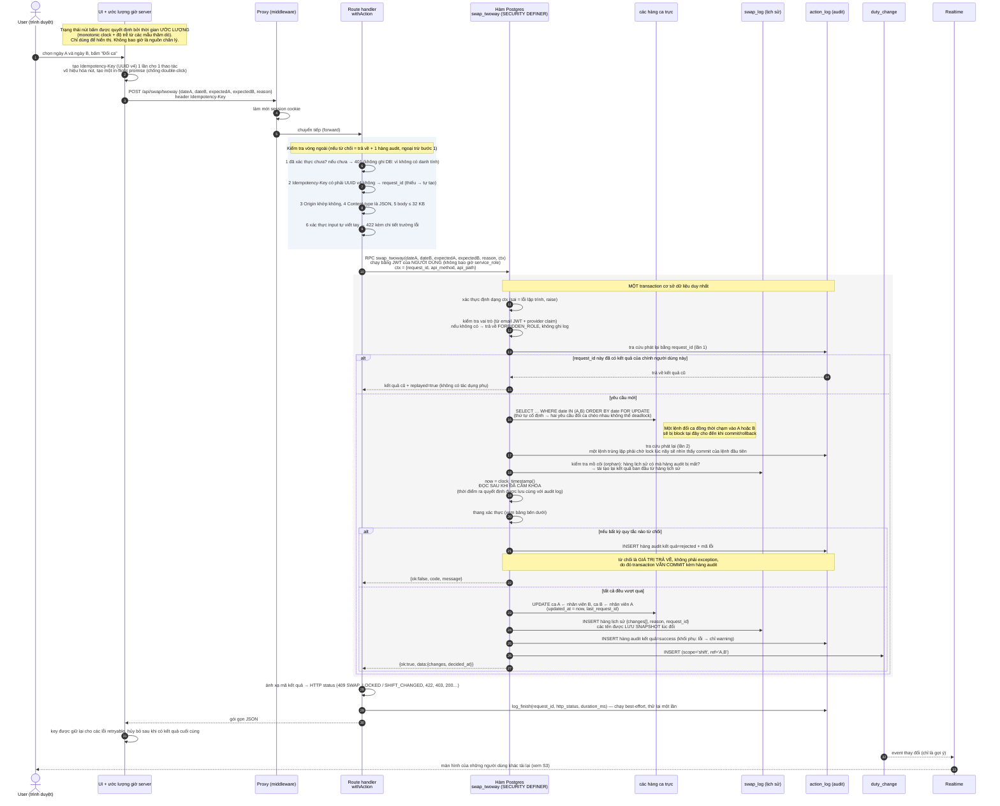
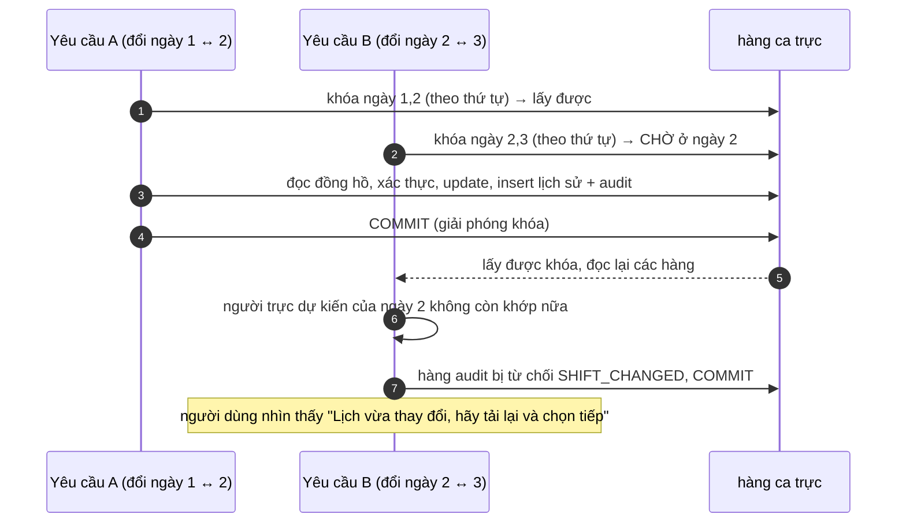
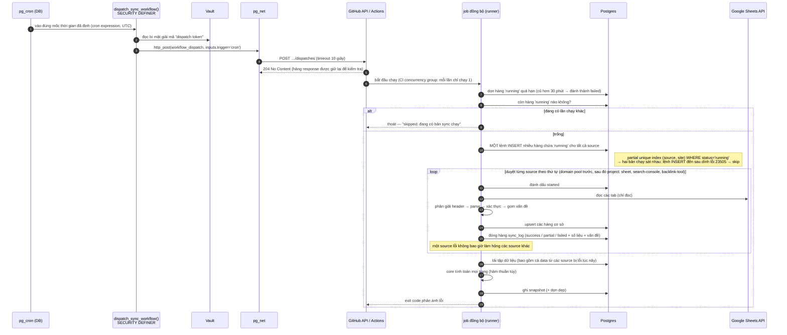
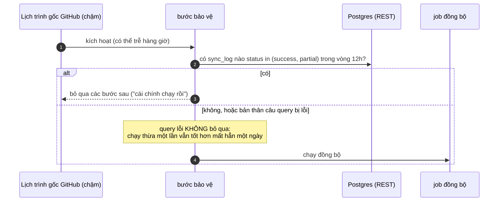
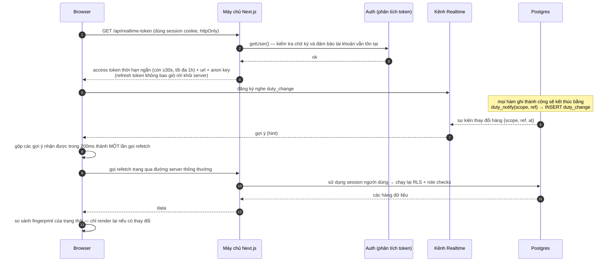
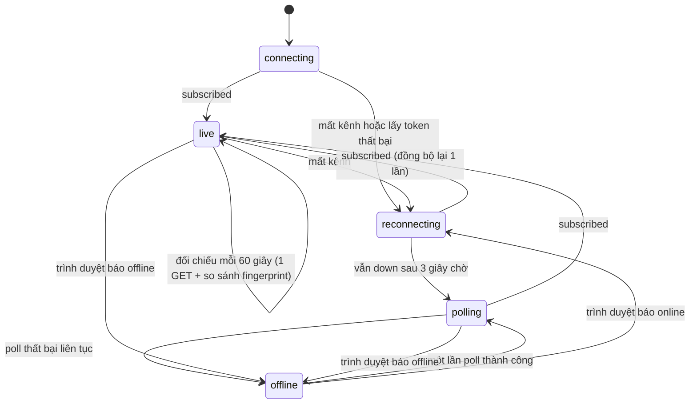
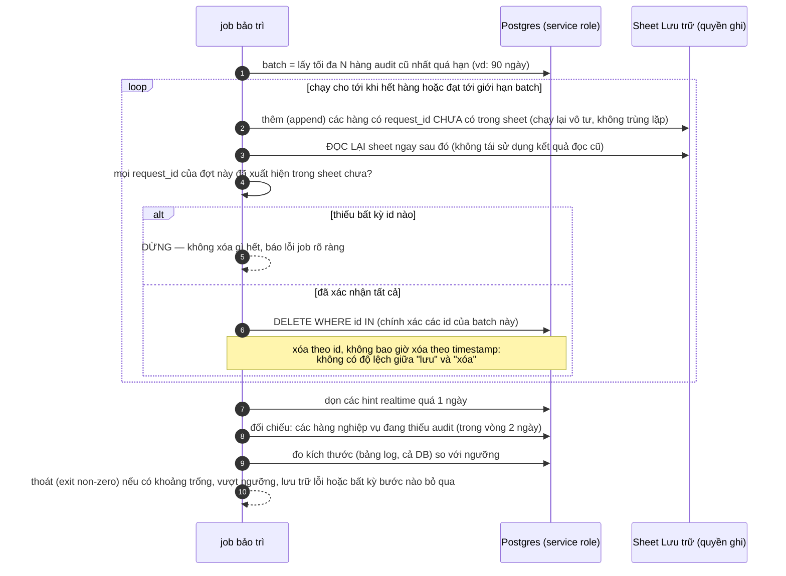

# 3. Biểu đồ Tuần tự

Có bốn luồng, khó nhất được đặt lên đầu:

| ID | Luồng | Điểm khó khăn |
|---|---|---|
| S1 | Đổi ca trực | Tính lũy đẳng + khóa hàng + **đồng hồ máy chủ trong transaction** + ghi log chính xác một hàng + thông báo realtime, dưới điều kiện nhiều người dùng đồng thời |
| S2 | Lên lịch đồng bộ dữ liệu | Bộ scheduler không đáng tin cậy → kích hoạt dư thừa nhưng tuyệt đối không được chạy hai lần |
| S3 | Làm mới thời gian thực | Giao diện Live mà không bao giờ cần tin tưởng vào dữ liệu từ kênh gửi tới |
| S4 | Lưu trữ log an toàn (Fail-closed) | Chỉ xóa những gì *đã được chứng minh* là lưu ở nơi khác |

---

## S1 — Đổi ca trực (hai chiều, có hiệu lực ngay lập tức)

Tác nhân: nhân viên đã đăng nhập tự đổi ca của *họ* trong một ngày với ca của người khác trong một ngày khác. Ở đây không có bước mời/chấp nhận; quá trình đổi diễn ra nguyên tử (atomic) và ngay lập tức, đồng thời được ghi lại ở bảng lịch sử hiển thị cho người dùng và bảng audit log chỉ dành cho dev.

### Thang xác thực (Thứ tự rất quan trọng)

Thứ tự được cố định một cách có chủ đích để lỗi *có ý nghĩa nhất* sẽ được trả về trước và các kiểm tra ít tốn kém sẽ nằm trước các kiểm tra trạng thái.

| # | Kiểm tra (Check) | Mã kết quả (Result code) |
|---|---|---|
| 1 | Người gọi có role trực ban | `FORBIDDEN_ROLE` (không có log) |
| 2 | Phát lại: cùng `request_id` đã được hoàn tất bởi người này | kết quả đã lưu, `replayed: true` |
| 3 | *(khóa 2 hàng, sau đó đọc đồng hồ DB)* | — |
| 4 | Cấu hình khung giờ khóa có thể đọc và hợp lệ (cấu hình hỏng ⇒ **khóa an toàn: locked**) | `SWAP_LOCKED` |
| 5 | Đầu vào: cả hai ngày đều có mặt, đúng format, có đủ `expected*`, lý do ≤ 500 ký tự | `VALIDATION_ERROR` |
| 6 | Hai ngày phải khác nhau | `SWAP_SAME_DAY` |
| 7 | Cả hai phải là ngày trong tuần | `SWAP_WEEKEND` |
| 8 | Không ngày nào nằm trong quá khứ | `SWAP_PAST_DATE` |
| 9 | Nếu ngày nào là **hôm nay**: nếu đang trong khung giờ khóa → `SWAP_LOCKED`; qua khỏi giờ khóa → `SWAP_DAY_ENDED` | `SWAP_LOCKED` / `SWAP_DAY_ENDED` |
| 10 | Cả hai ngày đều phải có người được gán trực | `SWAP_NO_STAFF` |
| 11 | Hai người phải khác nhau | `SWAP_SAME_STAFF` |
| 12 | Người gọi là 1 trong 2 người này (quản lý có thể đổi thay) | `SWAP_NOT_PARTICIPANT` |
| 13 | `expected*` phải khớp với người đang trực hiện tại (màn hình có bị cũ không?) | `SHIFT_CHANGED` |

### Các thuộc tính và cách đạt được chúng

| Thuộc tính | Cơ chế |
|---|---|
| **Hiệu lực chính xác một lần** dưới click đúp / retry / mạng chập chờn | Client gửi một `Idempotency-Key` trên mỗi intent. DB: dùng `UNIQUE (request_id)` cho cả bảng history và audit + phát lại (replay) trước *và sau* khi cầm khóa. |
| **Không có race condition kiểm tra/sử dụng** | Khóa trước, xem giờ thứ hai, xác thực thứ ba. Một yêu cầu phải chờ khóa sẽ được phán xét ở chính giây phút nó thực sự chạy. |
| **Quyền lực của đồng hồ** | `clock_timestamp()` trong DB. Đồng hồ của Client/app-server không bao giờ được dùng để ra quyết định. |
| **Đồng hồ Client không thể làm giả hoặc lệch** | Bộ ước lượng UI chỉ dùng monotonic clock + độ lệch từ các mẫu máy chủ (S3, đoạn mã 4.6); nếu nghi ngờ client máy đang ngủ ⇒ nút mờ đi cho đến khi đồng bộ lại. |
| **Không Deadlock** | Các hàng được khóa bằng `ORDER BY date`. |
| **Tính chính xác của ranh giới** | Khóa khi và chỉ khi `từ ≤ thời gian trong ngày < đến`. Đã test tại 15:29:59.999 (cho phép), 15:30:00.000 (chặn), 18:59:59.999 (chặn), 19:00:00.000 (cho phép) *và* với tiến trình test chạy ở một múi giờ khác. |
| **Tính trọn vẹn của Audit** | Một hàng audit cho mỗi request (`UNIQUE`), ghi bằng hàm trong cùng một giao dịch; một job đối chiếu sẽ đi tìm các hàng nghiệp vụ nếu nó thiếu hàng audit tương ứng. |
| **Việc ghi Log không thể làm hỏng hành động** | Thao tác insert audit nằm trong một sub-block (savepoint); nếu lỗi chỉ báo cảnh báo. |
| **Không thể giả mạo ủy quyền** | Danh tính đọc từ JWT ngay trong hàm. Không tồn tại tham số "actor" nào cả. |
| **Cấu hình an toàn (Fail-safe)** | Thiếu / hỏng cấu hình khóa hoặc `from ≥ to` sẽ bị coi là *khóa*. Mất chức năng đổi ca tạm thời vẫn tốt hơn là bị hở quyền trong lúc đang phát sóng trực tiếp. |

### Kịch bản đồng thời (Concurrency scenario)

### Chỗ của `pg_cron` trong hệ thống này

`pg_cron` **không** tham gia vào transaction đổi ca. Nó làm nhiệm vụ kích hoạt pipeline *đồng bộ* (S2). Khung giờ khóa đổi ca có ảnh hưởng gián tiếp đến việc lập lịch: hành động "chạy bảo trì" thủ công sẽ bị từ chối trong khung giờ khóa đổi ca, và job bảo trì tự động được đặt lịch bên ngoài khung giờ bận rộn.

---

## S2 — Lên lịch đồng bộ dữ liệu (kích hoạt dư thừa, không bao giờ chạy đúp)

### Đường dẫn dự phòng (scheduler gốc được biết là có lúc chậm hàng giờ)

Hai lớp chống chồng chéo độc lập: nhóm **`concurrency` của CI** (chi phí rẻ, nằm ở orchestrator) và **DB mutex** (mang tính thẩm quyền tuyệt đối, vẫn chạy đúng dù đổi orchestrator). Hết hạn do để quá lâu (30 phút) giúp ngăn trường hợp hệ thống crashed giữ khóa mãi mãi.

---

## S3 — Làm mới Thời gian thực (chỉ gợi ý, không phải data)

Các chế độ suy giảm (Máy trạng thái hiển thị trên giao diện dưới dạng thẻ kết nối):

Các trigger để đồng bộ lại (resync): tab đang ẩn biến thành visible, trình duyệt online lại, một bước check ổn định 5 giây sau mỗi lần subscribe (máy chủ realtime có thể chưa sẵn sàng phát tín hiệu lúc đó). Khoảng thời gian Polling là 5 giây.

Cách parse gợi ý mang tính phòng thủ: chỉ nhận những `scope` có trong danh sách trắng (whitelist) và một `ref` ngắn gọn; bất kỳ điều gì bất thường (payload trống, sai kiểu dữ liệu, sai scope) sẽ lập tức chuyển thành "refetch everything" (đồng bộ mọi thứ) — khi nghi ngờ, tải lại luôn an toàn hơn bỏ lỡ một thay đổi.

Lý do thiết kế này an toàn: Kênh truyền tải chỉ mang `{scope, ref, timestamp}`. Một token bị lộ hoặc event bị phát lại không tiết lộ nội dung gì cả, và nếu lỡ mất event thì đã có cơ chế đối chiếu/poll — tính đúng đắn của dữ liệu không bao giờ nằm trong tay kênh truyền này.

---

## S4 — Lưu trữ log an toàn (Fail-closed)

An toàn sau sự cố (Crash-safety): nếu việc xóa bị hỏng sau khi append thành công, ở lần chạy tới job sẽ nhận ra hàng đó đã được lưu trữ, nó sẽ bỏ qua bước append và chỉ tiến hành xóa. Các cột được lưu trữ loại bỏ hoàn toàn param, email, và dữ liệu kết quả thô.