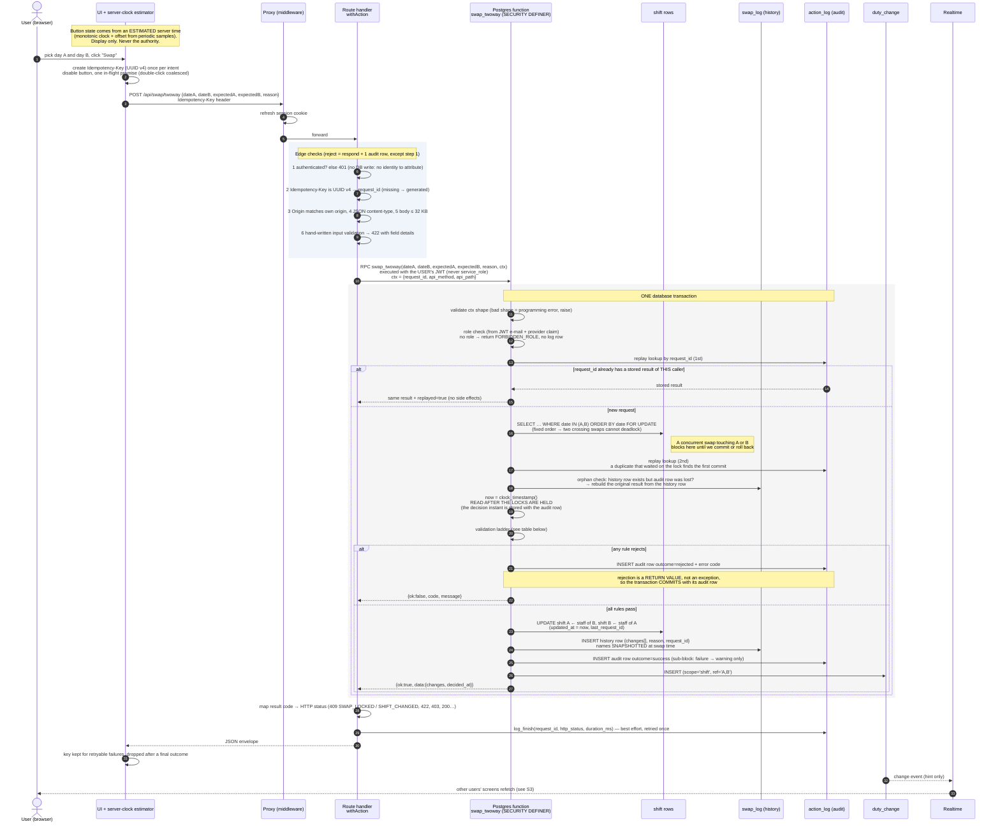
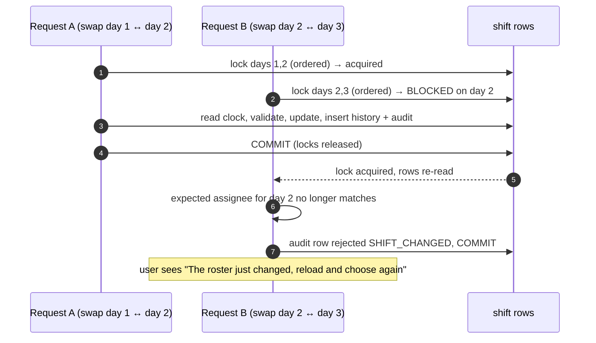
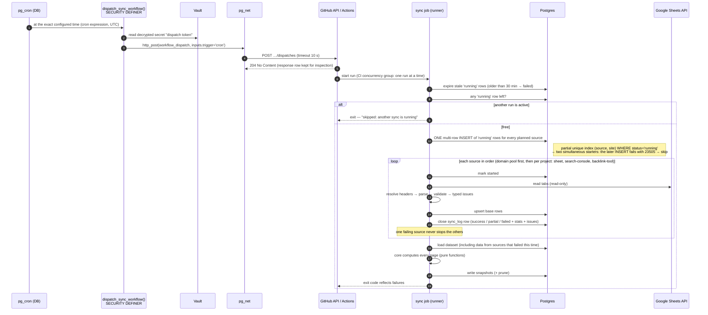
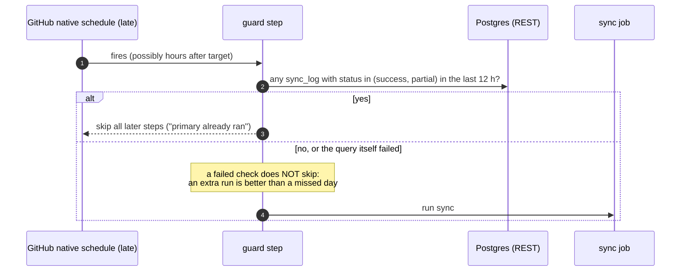
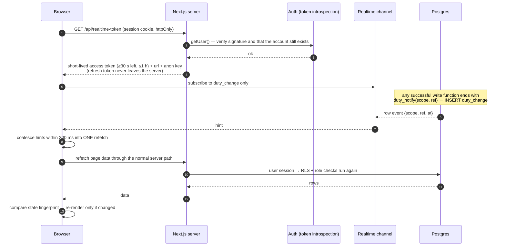
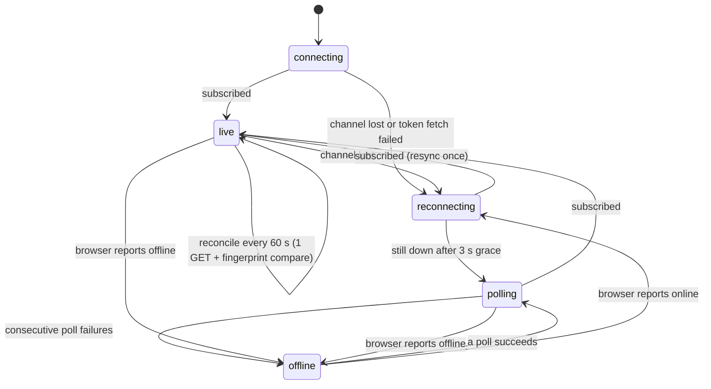
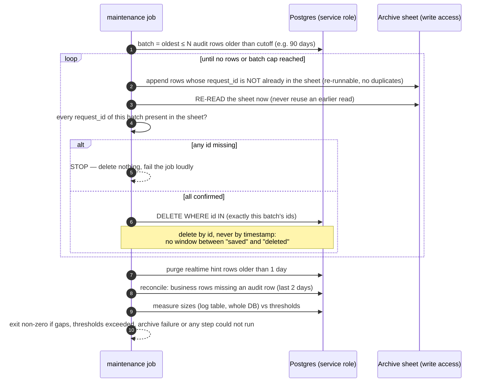

# 3. Sequence Diagrams

Four flows, hardest first:

| ID | Flow | Why it is hard |
|---|---|---|
| S1 | Shift swap | Idempotency + row locks + **in-transaction server clock** + exactly-one audit row + realtime notify, under concurrent users |
| S2 | Scheduled data sync | Unreliable scheduler → redundant triggers that must never double-run |
| S3 | Realtime refresh | Live UI without ever trusting the channel for data |
| S4 | Fail-closed log archiving | Delete only what is *proven* saved elsewhere |

---

## S1 — Shift swap (two-way, effective immediately)

Actors: a signed-in staff member swaps *their* shift on one day with another person's shift on another day. There is
no invitation/accept step; the swap is atomic and immediate, and is recorded in both a user-visible history table and
a dev-only audit log.

### Validation ladder (order matters)

The order was fixed deliberately so the *most meaningful* error wins and cheap checks precede state-dependent ones.

| # | Check | Result code |
|---|---|---|
| 1 | Caller has an on-call role | `FORBIDDEN_ROLE` (no log) |
| 2 | Replay: same `request_id` already done by this caller | stored result, `replayed: true` |
| 3 | *(lock the two rows, then read the DB clock)* | — |
| 4 | Lock-window config readable and valid (broken config ⇒ **fail safe: locked**) | `SWAP_LOCKED` |
| 5 | Input: both dates present and well-formed, `expected*` present, reason ≤ 500 chars | `VALIDATION_ERROR` |
| 6 | Dates differ | `SWAP_SAME_DAY` |
| 7 | Both are weekdays | `SWAP_WEEKEND` |
| 8 | Neither date is in the past | `SWAP_PAST_DATE` |
| 9 | If either date is **today**: inside the lock window → `SWAP_LOCKED`; past the window start → `SWAP_DAY_ENDED` | `SWAP_LOCKED` / `SWAP_DAY_ENDED` |
| 10 | Both days have a person assigned | `SWAP_NO_STAFF` |
| 11 | The two people differ | `SWAP_SAME_STAFF` |
| 12 | Caller is one of the two people (managers may swap on behalf) | `SWAP_NOT_PARTICIPANT` |
| 13 | `expected*` equals the current assignee (the screen was stale?) | `SHIFT_CHANGED` |

### Properties and how they are achieved

| Property | Mechanism |
|---|---|
| **Exactly-once effect** under double-click / retry / flaky network | Client sends one `Idempotency-Key` per intent. DB: `UNIQUE (request_id)` on history and audit tables + replay lookup before *and after* taking locks. |
| **No time-of-check/time-of-use race** | Locks first, clock second, validation third. A request that waited for a lock is judged at the moment it actually runs. |
| **Clock authority** | `clock_timestamp()` in the DB. Client/app-server clocks are never consulted for the decision. |
| **Client clock cannot be forged or drift** | The UI estimator uses only a monotonic clock plus an offset from server samples (S3, snippet 4.6); suspected sleep ⇒ the button dims until re-synced. |
| **No deadlock** | Rows are locked `ORDER BY date`. |
| **Boundary exactness** | Lock iff `from ≤ time-of-day < to`. Tested at 15:29:59.999 (allowed), 15:30:00.000 (blocked), 18:59:59.999 (blocked), 19:00:00.000 (allowed) *and* with the test process in a different timezone. |
| **Audit completeness** | One audit row per request (`UNIQUE`), written by the function in the same transaction; a reconciliation job finds business rows with no audit row. |
| **Logging cannot break the action** | Audit insert is in a sub-block (savepoint); on failure only a warning is raised. |
| **Authorization cannot be spoofed** | Identity read from the JWT inside the function. No "actor" parameter exists. |
| **Fail-safe configuration** | Missing / malformed / `from ≥ to` lock config is treated as *locked*. Losing swaps temporarily is better than unlocking during a live broadcast. |

### Concurrency scenario

### Where `pg_cron` appears in this system

`pg_cron` is **not** part of the swap transaction. It drives the *sync* pipeline (S2). The swap lock window does
influence scheduling indirectly: the manual "run maintenance" action is refused while the swap lock window is
active, and the scheduled maintenance job is placed outside the busy window.

---

## S2 — Scheduled data sync (redundant triggers, no double run)

### Backup path (the native scheduler is known to run hours late)

Two independent anti-overlap layers: **CI `concurrency` group** (cheap, in the orchestrator) and the **DB mutex**
(authoritative, survives a different orchestrator). Staleness expiry (30 min) prevents a crashed run from holding the
lock forever.

---

## S3 — Realtime refresh (hints, never data)

Degraded modes (state machine shown in the header as a connection badge):

Extra resync triggers: tab becomes visible, browser goes back online, one settle-check 5 s after each subscribe
(the realtime server may not be ready to emit yet). Polling interval is 5 s.

Hint parsing is defensive: only a whitelisted `scope` and a short `ref` are accepted; anything unexpected (empty
payload, wrong type, unknown scope) degrades to "refetch everything" — when in doubt, reload rather than miss a change.

Why this is safe: the channel carries `{scope, ref, timestamp}` only. A leaked token or replayed event reveals
nothing, and a missed event is repaired by reconcile/poll — correctness never depends on the channel.

---

## S4 — Fail-closed log archiving

Crash-safety: if the delete fails after the append succeeded, the next run finds the rows already archived, skips the
append, and only deletes. Archived columns exclude parameters, e-mail and raw results.
